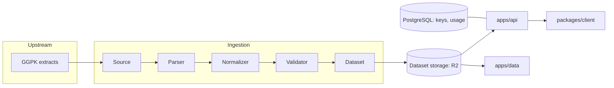

# ExileData

ExileData is a developer data platform for **Path of Exile 1 and Path of Exile 2** tooling: a
versioned, normalized, machine-readable dataset with a gated API and SDKs. PoE tool developers
get item, mod, gem, and passive data without embedding a JSON dump in their repo or writing
their own RePoE/PoEDB parser.

> **ExileData is an independent community project.** It is not affiliated with or endorsed by
> Grinding Gear Games, and it is not the official or authoritative source of Path of Exile data.

## Why this exists

Upstream sources like [RePoE](https://github.com/brather1ng/RePoE) and
[PoEDB](https://poedb.tw/) are excellent, but every PoE tool that wants this data ends up:

- embedding large, source-specific JSON blobs directly in its repo,
- writing its own ad-hoc normalization/parsing logic,
- coupling itself to upstream formats that can change without notice.

ExileData centralizes that work behind a stable, versioned contract: a canonical schema, a
gated HTTP API, and typed SDKs. One team absorbs upstream churn instead of every consumer
handling it separately.

## Architecture at a glance



- **`packages/schema`** — the canonical, source-agnostic ExileData data model. The most
  important package in the repo; see its README for the stable/source-specific/derived field
  conventions.
- **`packages/types`** — shared TypeScript types re-exporting the schema, plus API wire types.
- **`ingestion/common`, `ingestion/poe1`, `ingestion/poe2`** — the ingestion pipeline
  (`source → parser → normalized model → validator → dataset`). Both games' GGPK extracts share
  one format, so the extract stage lives in `ingestion/common` and each game package binds it.
- **`packages/storage`** — dataset storage drivers (local filesystem, R2), shared by ingestion
  and the API.
- **`apps/api`** — the versioned HTTP API (`/v1/...`), designed around dataset versions rather
  than an assumed-immutable "latest", plus the admin API and dashboard (`/admin`).
- **`packages/client`** — the TypeScript SDK consuming the API.
- **`packages/cli`** — operations CLI: `ingest`, `datasets list|delete`, `downloads publish|list`,
  `patch`, `update`, `db migrate`, `keys list|create|limit|revoke`.
- **`apps/data`** — the download server at data.exiledata.dev: a Worker serving published
  patches as files from R2, with no key and no rate limit.
- **`apps/web`** — the landing page at exiledata.dev. **`apps/docs`** — the documentation at
  docs.exiledata.dev, rendered from markdown plus an API reference generated from
  `apps/api/openapi.json`.
- **PostgreSQL** — holds application/service state (API clients, keys, usage), _not_ game data
  itself. Large immutable datasets are served from versioned storage, not rows in Postgres — see
  "Database" below.

## Current project status

Early stage, but live at `https://api.exiledata.dev`:

- Base items for both games are ingested from GGPK extracts and published to R2, one dataset
  per game patch.
- `GET /v1/{game}/bases` and `GET /v1/versions` serve them. `items`, `mods`, `gems` and `skills`
  still return `501 Not Implemented`.
- Every `/v1` route requires an API key, with a per-key rate limit and hourly usage counts.
  Keys are managed through the admin dashboard at `/admin` or the CLI's `keys` commands.
- Every exported game file of each patch, plus the normalized records and Path of Building's
  passive tree data, can be downloaded without a key from `https://data.exiledata.dev`, browsed
  at `https://docs.exiledata.dev/downloads`.
- A scheduled workflow publishes each new game patch; see "Keeping up with patches" below.

## Repository structure

```
apps/
  api/     — HTTP API (Fastify)
  web/     — landing page (static)
  docs/    — documentation site (markdown + OpenAPI, built to static HTML)
  data/    — download server for data.exiledata.dev (Worker over R2)
packages/
  schema/  — canonical ExileData schema
  types/   — shared types (re-exports schema + API and admin wire types)
  storage/ — dataset storage drivers (local, R2)
  client/  — TypeScript SDK
  cli/     — operations CLI
ingestion/
  common/  — pipeline interfaces, runner, and the shared GGPK extract stage
  poe1/    — PoE 1 ingestion
  poe2/    — PoE 2 ingestion
data/fixtures/ — small, hand-written test fixtures (never generated datasets)
migrations/    — PostgreSQL schema migrations (application state only)
docker/        — local infrastructure (PostgreSQL) and the API image
tests/         — cross-package tests; database tests run on in-process Postgres (PGlite)
.github/workflows/ — CI, deploys and the patch update
```

## Dataset architecture

Generated datasets are **never committed to this repository**. Git holds source code, schema,
migrations, ingestion logic, tests, and small fixtures only.

There is one dataset per game patch, stored as:

```
{game}/{gameVersion}/dataset.json
```

e.g. `poe2/4.5.5.3/dataset.json`. The patch comes from the extract's `version.txt`. Every
dataset carries metadata: `game`, `gameVersion`, `generatedAt`, `schemaVersion`, and source
information (see `DatasetMetadata` in `packages/schema`).

Re-ingesting a patch replaces its dataset (`exiledata ingest --overwrite`), and `generatedAt`
tells the builds apart. The API notices a replaced dataset through the storage ETag within a
minute, without a restart. "Latest" means the highest patch, compared numerically.

### Downloads

Published patches also live in the same bucket, under their own prefix:

```
downloads/index.json
downloads/{game}/{gameVersion}/manifest.json
downloads/{game}/{gameVersion}/{game}-{gameVersion}.zip
downloads/{game}/{gameVersion}/{game}-{gameVersion}-pob-tree-{tree}.zip
downloads/{game}/{gameVersion}/...   every exported file, normalized/ and pob_tree/
```

`exiledata downloads publish` writes them and `apps/data` serves them publicly; see their READMEs.
The API's datasets stay private: the download server reads nothing outside `downloads/`.

Storage is pluggable (`packages/storage`): a filesystem driver for local development, and a
[Cloudflare R2](https://developers.cloudflare.com/r2/) driver (S3-compatible, no egress fees) for
production, selected via `DATASET_STORAGE_DRIVER` in `.env`.

## Database

PostgreSQL is used for **application/service state only**: API clients, API keys, and hourly
usage counts (see `migrations/`). It does not store item/gem/mod/passive data — that belongs in
generated, versioned datasets served from optimized storage. This keeps the database small and
simple, and avoids coupling application state churn to dataset churn.

Apply migrations with `pnpm exiledata db migrate`. It records what it applied in
`schema_migrations` and skips those on the next run.

## Authentication

Every `/v1` route needs an API key, sent as `x-api-key: exd_...` or `Authorization: Bearer
exd_...`. `/health`, `/status` and `/admin` stay open. There is no billing system.

- **Keys** are stored as an HMAC-SHA256 of the key under `API_KEY_SECRET`, plus a short display
  prefix. The full key is shown once, when it is issued.
- **Rate limits** are per key, per minute, in memory. A second API replica would need a shared
  counter.
- **Usage** is counted per key per hour in `api_key_usage_hourly`, written in batches every
  10 seconds and on shutdown.
- **Admin** routes under `/admin/api` take `ADMIN_TOKEN` as a bearer token and answer 503 while
  it is unset. The dashboard at `/admin` and the CLI both use them:

```sh
pnpm exiledata keys create --client poe-overlay --rate-limit 300
pnpm exiledata keys list
pnpm exiledata keys limit <key-id> 600
pnpm exiledata keys revoke <key-id>
```

The CLI targets `https://api.exiledata.dev` unless `EXILEDATA_API_URL` or `--api-url` says
otherwise.

## Deployment

Deployment targets are chosen per workload rather than one platform for everything:

| Workload                | Target                             | Notes                                                                           |
| ----------------------- | ---------------------------------- | ------------------------------------------------------------------------------- |
| `apps/web`, `apps/docs` | Cloudflare Workers (static assets) | See each app's `wrangler.jsonc`; deployed via `.github/workflows/deploy.yml`    |
| `apps/data`             | Cloudflare Worker + R2 binding     | Public downloads; deployed by the same workflow                                 |
| Generated datasets      | Cloudflare R2                      | See "Dataset architecture" above                                                |
| `apps/api` + PostgreSQL | Existing dedicated server          | Long-running Fastify process + stateful DB; not a natural fit for Workers today |

`apps/web` and `apps/docs` are both static-assets Workers with no server-side code. `apps/docs` is
built first (`pnpm --filter @exiledata/docs build` writes `dist/site`); the deploy workflow runs
that step. See `apps/docs/README.md`.

To deploy manually from any of the three app directories: `pnpm deploy` (runs `wrangler deploy`; requires
`wrangler login` or `CLOUDFLARE_API_TOKEN`/`CLOUDFLARE_ACCOUNT_ID` env vars locally). CI deploys
automatically on push to `main` when files under `apps/web/`, `apps/docs/`, `apps/data/` or `apps/api/openapi.json` change — this
requires `CLOUDFLARE_API_TOKEN` and `CLOUDFLARE_ACCOUNT_ID` to be set as GitHub Actions secrets.

See [DEPLOYMENT.md](./DEPLOYMENT.md) for the current status and remaining setup steps (custom
domains, R2 bucket, dedicated server).

## Development setup

Requires [pnpm](https://pnpm.io/) (do not use npm or yarn) and Docker.

```sh
pnpm install
cp .env.example .env                                # then set API_KEY_SECRET and ADMIN_TOKEN
docker compose -f docker/docker-compose.yml up -d   # PostgreSQL
pnpm build                                          # the CLI runs against built packages
pnpm exiledata db migrate
```

### Run tests

```sh
pnpm test
```

Tests need no running database: they apply the real migrations to PGlite in-process.

### Run the API

```sh
pnpm dev:api
# -> http://localhost:3000/health, dashboard at http://localhost:3000/admin
```

### Update the OpenAPI document

Route schemas in `apps/api` are the source of the OpenAPI document. After changing a public
route, regenerate the committed copy, which the docs site renders:

```sh
pnpm openapi   # writes apps/api/openapi.json
```

A test fails while the committed file is stale.

### Ingest a dataset

```sh
pnpm exiledata ingest --game poe2 --extract-dir S:/POE2-Extracted/4.5.5.3-stripped
pnpm exiledata datasets list
```

Writes to the storage `DATASET_STORAGE_DRIVER` selects. Set it to `r2` for one command to
publish to production, e.g. `DATASET_STORAGE_DRIVER=r2 pnpm exiledata ingest ...`.

### Publish downloads

```sh
pnpm exiledata downloads publish --game poe2 --extract-dir S:/POE2-Extracted/4.5.5.3-stripped
pnpm exiledata downloads list
```

Run it after `ingest` for the same patch, with the same `DATASET_STORAGE_DRIVER`. The PoB tree
data is published when the extract has a `pob_tree/` folder, as `update` writes it.

### Keeping up with patches

```sh
pnpm exiledata patch                          # each game's current patch
pnpm exiledata update --check                 # which games are behind the published downloads
pnpm exiledata update                         # export, ingest and publish every game that is behind
pnpm exiledata update poe2 --force --dry-run  # rebuild one game without writing to storage
```

`update` asks GGG's patch servers for each game's current patch and compares it with the latest
patch in `downloads/index.json`. For each game that is behind, it exports that patch from the
patch CDN with [ggpk-explorer](https://github.com/juddisjudd/ggpk-explorer), so no game install
is needed: `export-data` for the game files, then `export-tree` for PoB's tree data into
`pob_tree/`. Then it ingests the extract and publishes the downloads. The extracts and
ggpk-explorer's log go to `work/{game}/`.

A dataset that is already in storage is kept; `--force` ingests and publishes again, replacing
both. `update` needs `ggpk-explorer` on `PATH`, or `GGPK_EXPLORER` set to it. On a machine
without the ggpk-explorer GUI's cached schema, set `DAT_SCHEMA` to a downloaded
[schema.min.json](https://github.com/poe-tool-dev/dat-schema/releases/latest/download/schema.min.json).

When a patch moves a table the schema reads, the export refuses that table rather than read the
wrong bytes. `update` then re-fits those tables against the previous patch with ggpk-explorer's
`refit`, and publishes only if every column was placed. GGG's CDN drops a patch once the next one
ships, so after each publish `update` keeps the patch's tables under `refit/{game}/{patch}/` in
the same bucket (private: the download server reads only `downloads/`). A patch that still cannot
be published is posted in `downloads/status.json`, which the Downloads page shows as a notice,
and the next run tries again. That is usually once dat-schema has caught up.

`.github/workflows/update.yml` runs it against R2 every six hours. See
[DEPLOYMENT.md](./DEPLOYMENT.md) for the secrets it needs.

### Run the landing page and docs

```sh
pnpm --filter @exiledata/web dev    # http://localhost:4000
pnpm --filter @exiledata/docs dev   # http://localhost:4100
```

### Build everything

```sh
pnpm build
```

### Lint & typecheck

```sh
pnpm lint
pnpm typecheck
```

## Contributing

See [CONTRIBUTING.md](./CONTRIBUTING.md).

## License

[MIT](./LICENSE) for the code in this repository. This license does not extend to any Path of
Exile game data, assets, or trademarks, all of which belong to Grinding Gear Games.
