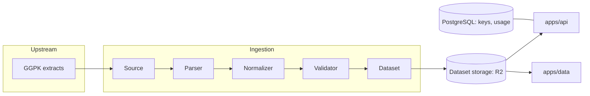

# ExileData

Path of Exile 1 and 2 game data for tool developers. Each game patch becomes one dataset of
normalized records, served over an HTTP API and published as JSON downloads.

- Landing page: https://exiledata.dev
- Docs: https://docs.exiledata.dev
- API: https://api.exiledata.dev
- Downloads: https://data.exiledata.dev

ExileData is an independent community project. It is not affiliated with or endorsed by Grinding
Gear Games, and it is not an official source of Path of Exile data.

## Status

Early, but live:

- Base items for both games are ingested from GGPK extracts and published to R2, one dataset per
  game patch.
- `GET /v1/{game}/bases` and `GET /v1/versions` serve them. `items`, `mods`, `gems` and `skills`
  return `501 Not Implemented`.
- Every `/v1` route needs an API key. Each key has its own rate limit and hourly usage counts.
  Keys are managed in the admin dashboard at `/admin` or with the CLI's `keys` commands.
- Every exported game file of each patch, the normalized records and Path of Building's passive
  tree data can be downloaded without a key from data.exiledata.dev. The docs have a
  [file browser](https://docs.exiledata.dev/downloads) for them.
- A scheduled workflow exports and publishes each new patch. See
  [Keeping up with patches](#keeping-up-with-patches).

## How it fits together



```
apps/
  api/       HTTP API (Fastify): /v1 routes, the admin API and the dashboard at /admin
  web/       landing page (static files, no build step)
  docs/      documentation site: markdown pages plus an API reference built from openapi.json
  data/      download server for data.exiledata.dev (a Cloudflare Worker over R2)
packages/
  schema/    the record format every dataset follows; its README explains the field groups
  types/     re-exports the schema, plus API and admin wire types
  storage/   dataset storage drivers (local filesystem, R2), shared by the CLI and the API
  cli/       operations CLI: ingest, publish, update, migrate, manage keys
ingestion/
  common/    pipeline interfaces, the stage runner and the GGPK extract stage
  poe1/      binds the extract stage for PoE 1
  poe2/      binds the extract stage for PoE 2
migrations/  PostgreSQL migrations (application state only)
docker/      local PostgreSQL and the API image
tests/       all tests; database tests run on in-process Postgres (PGlite)
```

Both games' extracts share one format, so the extract stage lives in `ingestion/common` and each
game package binds it. Game-specific handling goes in the game package when the formats diverge.

## Datasets

Generated datasets are never committed. Git holds code, schema, migrations and tests.

There is one dataset per game patch, stored as `{game}/{gameVersion}/dataset.json`, for example
`poe2/0.5.5.4/dataset.json`. The patch comes from the extract's `version.txt`. Each dataset
records its `game`, `gameVersion`, `generatedAt`, `schemaVersion` and sources (`DatasetMetadata`
in `packages/schema`).

Re-ingesting a patch replaces its dataset (`exiledata ingest --overwrite`), and `generatedAt`
tells the builds apart. The API sees a replaced dataset through the storage ETag within a minute,
without a restart. "Latest" is the highest patch, compared numerically, with one exception: PoE
2's old 4.x patches sort before its 0.x ones (`compareGameVersions` in `packages/storage`).

Storage has two drivers, chosen by `DATASET_STORAGE_DRIVER` in `.env`: the local filesystem for
development, and [Cloudflare R2](https://developers.cloudflare.com/r2/) for production.

### Downloads

Published patches live in the same bucket under their own prefix:

```
downloads/index.json
downloads/{game}/{gameVersion}/manifest.json
downloads/{game}/{gameVersion}/{game}-{gameVersion}.zip
downloads/{game}/{gameVersion}/{game}-{gameVersion}-pob-tree-{tree}.zip
downloads/{game}/{gameVersion}/...   every exported file, normalized/ and pob_tree/
```

`exiledata downloads publish` writes them and `apps/data` serves them. The download server reads
nothing outside `downloads/`, so the API's datasets stay private.

## Database

PostgreSQL holds application state only: API clients, API keys and hourly usage counts. Game data
stays in the versioned datasets, so a dataset rebuild never touches the database.

`pnpm exiledata db migrate` applies pending migrations. It records them in `schema_migrations`
and skips them on the next run.

## Authentication

Every `/v1` route needs an API key, sent as `x-api-key: exd_...` or
`Authorization: Bearer exd_...`. `/health`, `/status` and `/admin` stay open. There is no billing.

- Keys are stored as an HMAC-SHA256 under `API_KEY_SECRET`, plus a short display prefix. The full
  key is shown once, when it is issued.
- Rate limits are per key, per minute, held in memory. A second API replica would need a shared
  counter.
- Usage is counted per key per hour in `api_key_usage_hourly`. Counts are written every 10
  seconds and on shutdown.
- Admin routes under `/admin/api` take `ADMIN_TOKEN` as a bearer token and answer 503 while it is
  unset. The dashboard at `/admin` and the CLI both use them:

```sh
pnpm exiledata keys create --client poe-overlay --rate-limit 300
pnpm exiledata keys list
pnpm exiledata keys limit <key-id> 600
pnpm exiledata keys revoke <key-id>
```

The CLI talks to `https://api.exiledata.dev` unless `EXILEDATA_API_URL` or `--api-url` names
another API.

## Deployment

| Workload                | Target                             | How                                         |
| ----------------------- | ---------------------------------- | ------------------------------------------- |
| `apps/web`, `apps/docs` | Cloudflare Workers (static assets) | `.github/workflows/deploy.yml`              |
| `apps/data`             | Cloudflare Worker with R2 binding  | `.github/workflows/deploy.yml`              |
| Datasets and downloads  | Cloudflare R2                      | `exiledata ingest`, `downloads publish`     |
| `apps/api`, PostgreSQL  | A dedicated server                 | `docker/api.Dockerfile`; long-running state |

The deploy workflow runs on pushes to `main` that change `apps/web/`, `apps/docs/`, `apps/data/`
or `apps/api/openapi.json`. It builds the docs first (`pnpm --filter @exiledata/docs build`
writes `dist/site`).

To deploy by hand, run `pnpm deploy` in the app's directory. It runs `wrangler deploy` and needs
`wrangler login`, or `CLOUDFLARE_API_TOKEN` and `CLOUDFLARE_ACCOUNT_ID` in the environment.

The workflows need these repository secrets:

- `CLOUDFLARE_API_TOKEN` and `CLOUDFLARE_ACCOUNT_ID`, for deploys.
- `R2_ACCOUNT_ID`, `R2_ACCESS_KEY_ID`, `R2_SECRET_ACCESS_KEY` and `R2_BUCKET_NAME`, for the patch
  update and `current.json`.

## Development

Needs Node 22.13 or later, [pnpm](https://pnpm.io/) and Docker.

```sh
pnpm install
cp .env.example .env                                # then set API_KEY_SECRET and ADMIN_TOKEN
docker compose -f docker/docker-compose.yml up -d   # PostgreSQL
pnpm build                                          # the CLI runs against built packages
pnpm exiledata db migrate
```

| Task                        | Command                                       |
| --------------------------- | --------------------------------------------- |
| Run the tests               | `pnpm test`                                   |
| Lint and typecheck          | `pnpm lint` and `pnpm typecheck`              |
| Run the API on port 3000    | `pnpm dev:api`                                |
| Run the landing page (4000) | `pnpm --filter @exiledata/web dev`            |
| Run the docs (4100)         | `pnpm --filter @exiledata/docs dev`           |
| Regenerate the OpenAPI file | `pnpm openapi` (writes apps/api/openapi.json) |

Tests need no running database. They apply the real migrations to PGlite in-process.

Route schemas in `apps/api` are the source of the OpenAPI document. After changing a public
route, run `pnpm openapi`. A test fails while the committed copy is stale.

### Ingest and publish a patch

```sh
pnpm exiledata ingest --game poe2 --extract-dir work/poe2/0.5.5.4-stripped
pnpm exiledata downloads publish --game poe2 --extract-dir work/poe2/0.5.5.4-stripped
pnpm exiledata datasets list
pnpm exiledata downloads list
```

Both write to the storage that `DATASET_STORAGE_DRIVER` selects. To publish to production from
your machine, set it for one command: `DATASET_STORAGE_DRIVER=r2 pnpm exiledata ingest ...`.

Publish downloads after ingesting the same patch: the normalized records come from its dataset.
PoB tree data is published when the extract has a `pob_tree/` folder, as `update` writes it.

### Keeping up with patches

```sh
pnpm exiledata patch                          # each game's current patch
pnpm exiledata patch --publish                # also publish current.json to data.exiledata.dev
pnpm exiledata update --check                 # which games are behind the published downloads
pnpm exiledata update                         # export, ingest and publish every game that is behind
pnpm exiledata update poe2 --force --dry-run  # rebuild one game without writing to storage
```

`update` asks GGG's patch servers for each game's current patch and compares it with the latest
patch in `downloads/index.json`. For each game that is behind, it exports that patch from the
patch CDN with [ggpk-explorer](https://github.com/juddisjudd/ggpk-explorer), so no game install
is needed. `export-data` writes the game files and `export-tree` writes PoB's tree data into
`pob_tree/`. Then it ingests the extract and publishes the downloads. The extracts and
ggpk-explorer's log go to `work/{game}/`.

A dataset already in storage is kept. `--force` ingests and publishes again, replacing both.
`update` needs `ggpk-explorer` on `PATH`, or `GGPK_EXPLORER` set to it. On a machine without the
ggpk-explorer GUI's cached schema, set `DAT_SCHEMA` to a downloaded
[schema.min.json](https://github.com/poe-tool-dev/dat-schema/releases/latest/download/schema.min.json).

When a patch moves a table the schema reads, the export refuses that table instead of reading the
wrong bytes. `update` then re-fits those tables against the previous patch with ggpk-explorer's
`refit`, and publishes only if every column was placed. GGG's CDN drops a patch once the next one
ships, so after each publish `update` saves the patch's tables under `refit/{game}/{patch}/` in
the same bucket. That prefix is private too.

A patch that still cannot be published goes into `downloads/status.json`, and the Downloads page
shows it as a notice. The next run tries again. Usually it succeeds once dat-schema catches up.

`.github/workflows/update.yml` runs `update` against R2 every six hours.

## Contributing

See [CONTRIBUTING.md](./CONTRIBUTING.md).

## License

[MIT](./LICENSE) for the code in this repository. It does not cover Path of Exile game data,
assets or trademarks, which belong to Grinding Gear Games.
