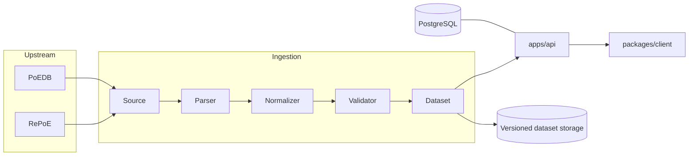

# ExileData

ExileData is a developer data platform for **Path of Exile 1 and Path of Exile 2** tooling: a
versioned, normalized, machine-readable dataset with a gated API and SDKs. PoE tool developers
get item, mod, gem, and passive data without embedding a JSON dump in their repo or writing
their own RePoE/PoEDB parser.

> **ExileData is an independent community project.** It is not affiliated with or endorsed by
> Grinding Gear Games, and it is not the official or authoritative source of Path of Exile data.

## Why this exists

Upstream sources like [RePoE](https://github.com/brather1ng/RePoE) and
[PoEDB](https://poedb.tw/) are excellent, but every PoE tool that wants this data ends up:

- embedding large, source-specific JSON blobs directly in its repo,
- writing its own ad-hoc normalization/parsing logic,
- coupling itself to upstream formats that can change without notice.

ExileData centralizes that work behind a stable, versioned contract: a canonical schema, a
gated HTTP API, and typed SDKs. One team absorbs upstream churn instead of every consumer
handling it separately.

## Architecture at a glance



- **`packages/schema`** — the canonical, source-agnostic ExileData data model. The most
  important package in the repo; see its README for the stable/source-specific/derived field
  conventions.
- **`packages/types`** — shared TypeScript types re-exporting the schema, plus API wire types.
- **`ingestion/common`, `ingestion/poe1`, `ingestion/poe2`** — the ingestion pipeline
  (`source → parser → normalized model → validator → dataset`), with PoE 1 and PoE 2 as
  independent implementations of shared interfaces.
- **`apps/api`** — the versioned HTTP API (`/v1/...`), designed around dataset versions rather
  than an assumed-immutable "latest".
- **`packages/client`** — the TypeScript SDK consuming the API.
- **`packages/cli`** — developer/data-operations CLI (`exiledata ingest|validate|build|diff|...`).
- **`apps/web`**, **`apps/docs`** — placeholder marketing site and documentation app.
- **PostgreSQL** — holds application/service state (API clients, keys, dataset metadata, usage),
  _not_ game data itself. Large immutable datasets are served from versioned storage, not rows in
  Postgres — see "Database" below.

## Current project status

Early-stage scaffold. The canonical schema, ingestion interfaces, API route structure, SDK
architecture, and CLI commands are established, but:

- no real ingestion from RePoE/PoEDB is implemented yet,
- no dataset has been generated,
- most API endpoints return `501 Not Implemented`,
- authentication is architected but not enforced yet.

## Repository structure

```
apps/
  api/     — HTTP API (Fastify)
  web/     — placeholder marketing site
  docs/    — placeholder documentation app
packages/
  schema/  — canonical ExileData schema
  types/   — shared types (re-exports schema + API wire types)
  client/  — TypeScript SDK
  cli/     — developer CLI
ingestion/
  common/  — shared ingestion pipeline interfaces
  poe1/    — PoE 1 ingestion (architecture only)
  poe2/    — PoE 2 ingestion (architecture only)
data/fixtures/ — small, hand-written test fixtures (never generated datasets)
migrations/    — PostgreSQL schema migrations (application state only)
docker/        — local infrastructure (PostgreSQL)
tests/         — cross-package tests (schema, API health, config, SDK, boundaries)
.github/workflows/ — CI
```

## Dataset architecture

Generated datasets are **never committed to this repository**. Git holds source code, schema,
migrations, ingestion logic, tests, and small fixtures only.

Datasets are conceptually organized as:

```
dataset/
  {game}/
    {game-version}/
      {dataset-version}/
```

e.g. `poe2/0.x/2026.09.03.1/`. Every dataset carries metadata: `game`, `gameVersion`,
`datasetVersion`, `generatedAt`, `schemaVersion`, and source information (see `DatasetMetadata`
in `packages/schema`). The exact versioning scheme is expected to evolve.

Actual storage is pluggable (`ingestion/common/src/storage`): a filesystem driver for local
development, and a [Cloudflare R2](https://developers.cloudflare.com/r2/) driver (S3-compatible,
no egress fees) for production, selected via `DATASET_STORAGE_DRIVER` in `.env`.

## Database

PostgreSQL is used for **application/service state only**: API clients, API keys, dataset
version metadata, usage tracking, and permissions (see `migrations/0001_initial.sql`). It does
not store item/gem/mod/passive data — that belongs in generated, versioned datasets served from
optimized storage. This keeps the database small and simple, and avoids coupling application
state churn to dataset churn.

## Authentication

The API is designed for authenticated, rate-limited access from day one, even while free. See
`apps/api/src/plugins/auth.ts` for the current (architecture-only) state, and
`migrations/0001_initial.sql` for the planned `api_keys` shape (revocation, per-key rate limits,
usage tracking). There is no billing system.

## Deployment

Deployment targets are chosen per workload rather than one platform for everything:

| Workload                | Target                             | Notes                                                                           |
| ----------------------- | ---------------------------------- | ------------------------------------------------------------------------------- |
| `apps/web`, `apps/docs` | Cloudflare Workers (static assets) | See each app's `wrangler.jsonc`; deployed via `.github/workflows/deploy.yml`    |
| Generated datasets      | Cloudflare R2                      | See "Dataset architecture" above                                                |
| `apps/api` + PostgreSQL | Existing dedicated server          | Long-running Fastify process + stateful DB; not a natural fit for Workers today |

`apps/web` is a pure static-assets Worker (no server-side code). `apps/docs` has a small Worker
(`apps/docs/worker.ts`) that maps a URL path to `content/{slug}.md` via the assets binding — it
mirrors `src/server.ts`, which remains the local-dev entrypoint (`pnpm dev`).

To deploy manually from either app directory: `pnpm deploy` (runs `wrangler deploy`; requires
`wrangler login` or `CLOUDFLARE_API_TOKEN`/`CLOUDFLARE_ACCOUNT_ID` env vars locally). CI deploys
automatically on push to `main` when files under `apps/web/` or `apps/docs/` change — this
requires `CLOUDFLARE_API_TOKEN` and `CLOUDFLARE_ACCOUNT_ID` to be set as GitHub Actions secrets.

See [DEPLOYMENT.md](./DEPLOYMENT.md) for the current status and remaining setup steps (custom
domains, R2 bucket, dedicated server).

## Development setup

Requires [pnpm](https://pnpm.io/) (do not use npm or yarn) and Docker.

```sh
pnpm install
cp .env.example .env
docker compose -f docker/docker-compose.yml up -d   # PostgreSQL
```

### Run tests

```sh
pnpm test
```

### Run the API

```sh
pnpm --filter @exiledata/api dev
# -> http://localhost:3000/health
```

### Run the web/docs placeholders

```sh
pnpm --filter @exiledata/web dev    # http://localhost:4000
pnpm --filter @exiledata/docs dev   # http://localhost:4100
```

### Build everything

```sh
pnpm build
```

### Lint & typecheck

```sh
pnpm lint
pnpm typecheck
```

## Contributing

See [CONTRIBUTING.md](./CONTRIBUTING.md).

## License

[MIT](./LICENSE) for the code in this repository. This license does not extend to any Path of
Exile game data, assets, or trademarks, all of which belong to Grinding Gear Games.
